# 🤖 Awesome-AI-Agent-Infrastructure-Autonomous-Systems

  

  

### 🌐 The Definitive Directory for Production Agentic AI, Autonomous Workforces, and Execution Runtimes

---

## 📖 Overview

A meticulously curated index of top-tier **SaaS platforms** and **open-source GitHub repositories** powering the **AI Agent Infrastructure & Autonomous Systems Ecosystem**. Whether you are building self-hosted autonomous agent teams, provisioning secure Firecracker microVM sandboxes, integrating Model Context Protocol (MCP) gateways, or implementing hierarchical persistent memory kernels, this repository serves as your production-grade architectural guide.

### 🎯 Key Focus Areas
- 🧠 **Autonomous Agent Workforces & Multi-Agent Swarms**: Orchestrating autonomous worker topologies with dynamic role assignment.
- 📦 **Secure Sandboxed Runtimes**: Isolated Firecracker microVM, WASM, and Docker execution kernels for untrusted agent code and browser use.
- 💾 **Persistent Hierarchical Memory**: Self-editing episodic, semantic, and working memory layers (MemGPT/Letta, Mem0, Graphiti).
- 🔌 **Tool Call Gateways & Protocols**: Open standards including Anthropic's Model Context Protocol (MCP) for tool discovery.
- 📊 **Agent Telemetry & Evals**: OpenTelemetry-native trace waterfalls, recursive step replay, regression scoring, and trajectory monitoring.

---

## 📑 Table of Contents
- [📖 Overview](#-overview)
- [📊 Sector Overview & Market Dynamics](#-sector-overview--market-dynamics)
- [☁️ SaaS & Hosted Platforms](#️-saashosted-platforms)
- [🐙 Open-Source GitHub Projects](#-open-source-github-projects)
- [📈 Star History](#-star-history)
- [🤝 How to Contribute](#-how-to-contribute)
- [☕ Support](#-support)
- [⚖️ Disclaimer](#️-disclaimer)

---

## 📊 Sector Overview & Market Dynamics

The global AI Agent market is projected to reach **$10.9B – $11.55B in 2026** (expanding at a hyper-growth CAGR of **43%–49%** toward $150B+ by the 2030s). The sector exhibits a distinct two-tier market structure: while foundational model compute and enterprise operational workflows remain **concentrated** among hyperscalers and legacy enterprise software giants, the application, orchestration, sandbox runtime, and tool-integration infrastructure layers are **heavily fragmented** among specialized, fast-moving innovators and vibrant open-source ecosystems.

---

## ☁️ SaaS/Hosted Platforms

The table below lists premier enterprise SaaS platforms delivering managed AI agent runtimes, sandbox execution, agent telemetry, and workforce orchestration. Products are sorted in **descending order by company valuation/scale**.

| 🏢 Platform | 💰 Valuation / Company Size | 🏷️ Starting Pricing Tier | 🎁 Free Tier / Trial Limits | 🔍 Core Agent Capabilities |
| :--- | :--- | :--- | :--- | :--- |
| **[LangChain Hub & LangSmith](https://langchain.com)** | **$3.0 Billion** (Series C, 7,000+ enterprise clients) | **$39 / seat / month** (Plus Plan) | **Developer Plan (Free forever)**: 1 seat, 5,000 base traces/month, 14-day data retention | Managed deployment, LangGraph agent workflows, prompt versioning, full trajectory evals |
| **[Braintrust](https://braintrust.dev)** | **$800 Million** (Series B) | **$249 / month** (Pro Plan) | **Starter Plan (Free forever)**: Unlimited seats/projects, 10,000 scores/month, 1 GB data/month, 14-day retention, $10/month model credits | Enterprise automated evaluation, prompt playground, trace scoring, regression benchmarks |
| **[Dify Enterprise / Cloud](https://dify.ai)** | **$180 Million** (Series Pre-A, 1.4M+ instances) | **$59 / workspace / month** (Professional Plan) | **Sandbox Plan (Free forever)**: 1 workspace, 1 member, 5 apps, 50 docs, 200 message credits (one-time trial) | Visual agent flow orchestrator, RAG ingestion, model routing gateway, SSO/RBAC governance |
| **[CrewAI Enterprise](https://crewai.com)** | **~$100M – $177 Million** ($18M Series A) | **Custom Quote** (~$60k/yr enterprise; AMP Pro self-serve) | **Basic Plan (Free forever)**: 1 member, visual studio editor, GitHub sync, 50 workflow executions/month | Enterprise multi-agent orchestration, deterministic Flows, RBAC security, audit replays |
| **[E2B Cloud](https://e2b.dev)** | **~$100M – $250 Million** ($21M Series A; $120M ARR run-rate) | **$150 / month** (Pro Plan flat infra fee + pay-as-you-go compute) | **Hobby Plan (Free forever)**: $100 one-time usage credits, 20 concurrent microVMs, 1-hour max session duration | Firecracker MicroVM isolated sandboxes for LLM code execution, browser-use, terminal actions |
| **[SuperAGI Cloud](https://superagi.com)** | **~$50M – $100 Million** ($15M total funding) | **$49 / user / month** (Starter Cloud Plan) | **Lite Plan (Free forever)**: 1 seat, 100–500 monthly workflow credits, limited daily prospecting caps | Autonomous agent provisioning, agent marketplace, concurrent workers, vector memory |
| **[Letta Platform (Letta Cloud)](https://letta.com)** | **$70 Million** ($10M Seed backed by Felicis & Founders Fund) | **$20 / user / month** (Pro Plan) | **Free Cloud Tier (Free forever)**: Managed stateful agent hosting with BYO (Bring-Your-Own) API keys, community limits | Stateful agent runtime (MemGPT architecture), perpetual hierarchical memory, multi-session context |
| **[Fixie.ai (Ultravox)](https://fixie.ai)** | **$51.5 Million** ($17M Seed; acquired by Inworld AI) | **$100 / month** (Pro Plan; or $0.05/min pay-as-you-go) | **Free Developer Tier (Free forever)**: 30 minutes free voice calls, up to 5 concurrent sessions, unlimited playground | Real-time speech-to-speech voice agent runtime, external API integration, streaming LLM audio |
| **[Relevance AI](https://relevanceai.com)** | **~$40M – $60 Million** ($37M total funding, Series B) | **$29 / month** ($19/mo billed annually - Pro Plan) | **14-Day Free Trial**: Full access to explore agent builders, 100 test actions & vendor credits (no permanent free tier) | No-code B2B autonomous workforce builder, multi-agent chaining, scheduled background workers |
| **[AgentOps](https://agentops.ai)** | **Seed-stage (~$10M – $20M est.)** (Y Combinator backed) | **$40 / month** (Pro Plan) | **Basic Plan (Free forever)**: 5,000 events/month, 7-day data retention, full session replays | Specialized multi-agent monitoring, step replay, tool call execution debugging, LLM spend caps |

---

## 🐙 Open-Source GitHub Projects

Explore the most powerful open-source repositories powering autonomous agents, isolated sandboxes, memory kernels, and inference engines. Repositories are sorted in **descending order by GitHub stargazers**.

| 📦 Repository & Project | 🌟 Stars | 📜 License | 💡 Architectural Focus & Highlights |
| :--- | :---: | :---: | :--- |
| **[n8n-io/n8n](https://github.com/n8n-io/n8n)** |  | `Sustainable` | Fair-code workflow automation platform with native AI agent steps, LangChain nodes, and 400+ connectors. |
| **[Significant-Gravitas/AutoGPT](https://Significant-Gravitas/AutoGPT)** |  | `MIT` | The pioneering autonomous agent architecture powering multi-step self-prompting and goal-driven tasks. |
| **[ollama/ollama](https://github.com/ollama/ollama)** |  | `MIT` | Ultra-fast local model execution engine serving private, air-gapped LLM inference for autonomous agents. |
| **[langgenius/dify](https://github.com/langgenius/dify)** |  | `Dify Open` | Production-ready self-hosted platform combining agentic workflows, RAG pipelines, and model gateways. |
| **[browser-use/browser-use](https://github.com/browser-use/browser-use)** |  | `MIT` | Open-source Python library empowering autonomous agents to control web browsers via structured DOM parsing. |
| **[vllm-project/vllm](https://github.com/vllm-project/vllm)** |  | `Apache-2.0` | High-throughput, memory-efficient LLM inference server featuring PagedAttention for high-concurrency agents. |
| **[All-Hands-AI/OpenHands](https://github.com/All-Hands-AI/OpenHands)** |  | `MIT` | Autonomous software development agent operating within secure Docker runtimes with bash, editor, and browser tools. |
| **[modelcontextprotocol/servers](https://github.com/modelcontextprotocol/servers)** |  | `MIT` | Official reference server implementations for Anthropic's Model Context Protocol (MCP) tool integration. |
| **[mem0ai/mem0](https://github.com/mem0ai/mem0)** |  | `Apache-2.0` | Production drop-in memory infrastructure providing persistent user, session, and multi-agent recall. |
| **[BerriAI/litellm](https://github.com/BerriAI/litellm)** |  | `MIT` | High-speed AI Gateway proxying 100+ LLMs with unified OpenAI formatting, budget tracking, and load balancing. |
| **[microsoft/autogen](https://github.com/microsoft/autogen)** |  | `CC-BY-4.0` | Multi-agent conversation framework and event-driven runtime for developing collaborative autonomous systems. |
| **[crewAIInc/crewAI](https://github.com/crewAIInc/crewAI)** |  | `MIT` | Framework for orchestrating role-playing autonomous agents, autonomous task delegation, and deterministic Flows. |
| **[run-llama/llama_index](https://github.com/run-llama/llama_index)** |  | `MIT` | Context augmentation platform connecting agentic workflows to enterprise data sources, indices, and tools. |
| **[langchain-ai/langgraph](https://github.com/langchain-ai/langgraph)** |  | `MIT` | Resilient framework for building cyclic, stateful multi-agent systems with persistence and human interrupts. |
| **[khoj-ai/khoj](https://github.com/khoj-ai/khoj)** |  | `GPL-3.0` | Open-source autonomous AI personal assistant and second brain supporting self-hosted local and cloud models. |
| **[langfuse/langfuse](https://github.com/langfuse/langfuse)** |  | `MIT` | OpenTelemetry-native engineering platform for full-stack agent tracing, evals, prompt management, and metrics. |
| **[qdrant/qdrant](https://github.com/qdrant/qdrant)** |  | `Apache-2.0` | High-performance Rust vector search engine optimized for fast semantic filtering and agent memory retrieval. |
| **[getzep/graphiti](https://github.com/getzep/graphiti)** |  | `Apache-2.0` | Dynamic temporal knowledge graph memory framework designed specifically for stateful autonomous agents. |
| **[activepieces/activepieces](https://github.com/activepieces/activepieces)** |  | `MIT` | Open-source workflow automation engine with ~400 MCP servers, AI agent steps, and enterprise connectors. |
| **[letta-ai/letta](https://github.com/letta-ai/letta)** |  | `Apache-2.0` | Stateful agent server (MemGPT architecture) providing persistent self-editing memory and daemon operations. |
| **[temporalio/temporal](https://github.com/temporalio/temporal)** |  | `MIT` | Durable execution engine guaranteeing state persistence, failure recovery, and retries for long-running agents. |
| **[camel-ai/camel](https://github.com/camel-ai/camel)** |  | `Apache-2.0` | Multi-agent communication framework researching communicative agents, scalable swarms, and synthetic data. |
| **[TransformerOptimus/SuperAGI](https://github.com/TransformerOptimus/SuperAGI)** |  | `MIT` | Dev-first autonomous agent infrastructure supporting concurrent execution, trajectory replays, and vector DBs. |
| **[eigent-ai/eigent](https://github.com/eigent-ai/eigent)** |  | `Apache-2.0` | Open-source multi-agent desktop workforce application executing collaborative workflows across files, MCP tools, and browsers. |
| **[e2b-dev/E2B](https://github.com/e2b-dev/E2B)** |  | `Apache-2.0` | Secure MicroVM sandboxing SDK allowing autonomous agents to safely run Python, JS, and shell actions. |
| **[Arize-ai/phoenix](https://github.com/Arize-ai/phoenix)** |  | `ELv2` | OpenTelemetry AI observability and evaluation platform with interactive multi-agent trace waterfalls. |
| **[tensorzero/tensorzero](https://github.com/tensorzero/tensorzero)** |  | `Apache-2.0` | High-throughput Rust LLM gateway unifying routing, observability, model optimization, and evals. |
| **[hatchet-dev/hatchet](https://github.com/hatchet-dev/hatchet)** |  | `Apache-2.0` | Distributed orchestration engine for durable background tasks, concurrency queuing, and multi-step agent flows. |
| **[traceloop/openllmetry](https://github.com/traceloop/openllmetry)** |  | `Apache-2.0` | Zero-code OpenTelemetry instrumentation standard for tracking multi-agent calls, vector DBs, and LLM queries. |
| **[NVIDIA/NeMo-Guardrails](https://github.com/NVIDIA/NeMo-Guardrails)** |  | `Apache-2.0` | Programmable runtime rails enforcing safety, factual grounding, and execution constraints on autonomous agents. |
| **[agiresearch/AIOS](https://github.com/agiresearch/AIOS)** |  | `MIT` | LLM Agent Operating System provisioning kernel-level scheduling, memory context switching, and access controls. |
| **[openlit/openlit](https://github.com/openlit/openlit)** |  | `Apache-2.0` | OpenTelemetry-native monitoring and cost management framework tracking GPU, token spend, and agent performance. |

---

## 📈 Star History

---

## 🤝 How to Contribute

Contributions are highly encouraged! To add or update an entry:

1. **Fork the Repository**: Click the `Fork` button at the top right of this page.
2. **Create a Feature Branch**: `git checkout -b feature/add-new-agent-tool`
3. **Add Entry**:
   - For **SaaS Products**: Add to the table with exact valuation/size, specific starting tier pricing, and concrete free tier/trial limits.
   - For **Open-Source Projects**: Add with an official star badge (`style=social&color=white`) linking to its stargazers page.
4. **Format & Verify**: Ensure clean Markdown formatting and valid HTTPS URLs.
5. **Submit a Pull Request**: Provide a concise summary of why the tool is essential for autonomous agent infrastructure.

---

## ☕ Support

If you find this curated collection valuable for your AI engineering workflows, agent designs, or infrastructure research, please consider supporting the project:

- ⭐ **Star this repository** to help others discover it on GitHub!
- 🍴 **Fork and contribute** your own tools, frameworks, and benchmarks.
- 📢 **Share with peers** across Twitter/X, LinkedIn, Discord, and Reddit.
- ☕ **Sponsor the Maintainer**: Buy a coffee or become a recurring sponsor via the [GitHub Sponsors Dashboard](https://github.com/sponsors/ishandutta2007).

Your backing directly fuels continuous curation and verification of the rapidly evolving autonomous AI ecosystem! ❤️

---

## ⚖️ Disclaimer

*This list is maintained for educational and architectural reference purposes. Trademarks, service marks, and company names belong to their respective owners. Information on pricing, limits, and valuations is compiled from public disclosures and may change over time.*
